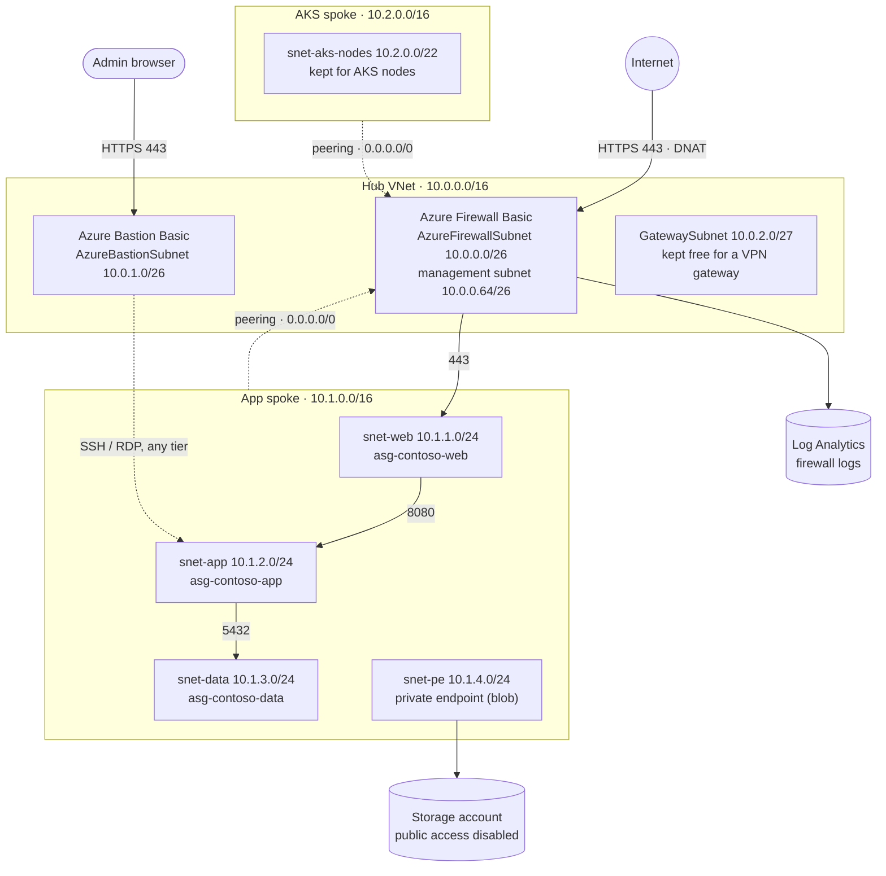

# Azure hub-and-spoke network foundation

A hub-and-spoke network for Azure, written in Terraform, for a fictional company (Contoso) that is moving its applications from a small datacenter to Azure. The hub holds the shared services: Azure Firewall Basic as the single path for workload traffic to and from the internet, Azure Bastion for admin access, and a gateway subnet kept free for a future site-to-site VPN. One spoke hosts a three-tier application (web, app, data) and a subnet for private endpoints; the other spoke is reserved for an AKS cluster. Workload subnets have no default internet access, each spoke sends its internet-bound traffic to the firewall, network security groups separate the tiers, the storage account is reachable only through a private endpoint, and the firewall's logs go to a Log Analytics workspace.

> Personal lab project, being built step by step in a sandbox subscription; the Terraform is validated offline (terraform validate), not applied as a whole.
>
> In the sandbox, Azure Firewall and Bastion go only as far as the portal's validation step (Review + create, then "Validation passed"); they are not deployed, because they are slow to deploy and billed by the hour.

**Contents:** [Architecture](#architecture) · [Address plan](#address-plan) · [What is in the repository](#what-is-in-the-repository) · [Key design decisions](#key-design-decisions) · [Security choices](#security-choices) · [How to use it](#how-to-use-it) · [Cloud Shell scripts](#cloud-shell-scripts) · [What I would change for production](#what-i-would-change-for-production)

## Architecture



- Solid arrows are allowed traffic: the published web app, the tier-to-tier flows, the admin's HTTPS session to Bastion, the private endpoint's link to storage and the firewall's logs. Dotted arrows are Bastion's SSH and RDP sessions to the VMs (one arrow stands for all three tiers), and each spoke's link to the hub: the spoke is peered with the hub, and its route table sends 0.0.0.0/0 to the firewall.
- The spokes peer only with the hub. Peering is not transitive, so traffic between the spokes would have to cross the firewall, and no firewall rule allows it.
- The VNets are named `vnet-contoso-hub`, `vnet-contoso-app` and `vnet-contoso-aks` (default prefix).
- Not drawn: `snet-shared` (10.0.3.0/24, kept free in the hub for shared services) and the two private DNS zones, `contoso.internal` and `privatelink.blob.core.windows.net`, both linked to the three VNets.

## Address plan

One /16 per VNet, with no overlap between the VNets or with the planned on-premises range. Azure keeps 5 addresses in every subnet, which gives the usable counts below. The names of the VNets, NSGs, ASGs, route tables, public IPs, firewall, Bastion, storage account and workspace include the `prefix` variable (default `contoso`). Subnet names are fixed, and Azure requires the exact names of the four special subnets.

| VNet / subnet | Range | Usable | Purpose |
|---|---|---|---|
| **vnet-contoso-hub** | 10.0.0.0/16 | | Shared services for every spoke |
| AzureFirewallSubnet | 10.0.0.0/26 | 59 | Azure Firewall (/26 minimum) |
| AzureFirewallManagementSubnet | 10.0.0.64/26 | 59 | Management traffic of Firewall Basic (/26 minimum) |
| AzureBastionSubnet | 10.0.1.0/26 | 59 | Azure Bastion (/26 or larger) |
| GatewaySubnet | 10.0.2.0/27 | 27 | Kept free for a VPN gateway (/27 or larger: required by every VPN gateway SKU except Basic) |
| snet-shared | 10.0.3.0/24 | 251 | Kept free for shared services, such as domain controllers or DNS forwarder VMs (an Azure DNS Private Resolver would need its own delegated subnets, one per endpoint) |
| **vnet-contoso-app** | 10.1.0.0/16 | | The application spoke |
| snet-web | 10.1.1.0/24 | 251 | Web tier; the DNAT rule targets 10.1.1.4 |
| snet-app | 10.1.2.0/24 | 251 | Application tier |
| snet-data | 10.1.3.0/24 | 251 | Data tier |
| snet-pe | 10.1.4.0/24 | 251 | Private endpoints |
| **vnet-contoso-aks** | 10.2.0.0/16 | | The AKS spoke |
| snet-aks-nodes | 10.2.0.0/22 | 1,019 | AKS nodes; with Azure CNI Overlay, pods take addresses from a separate private range |
| *On-premises (planned)* | 192.168.0.0/16 | | No overlap with the Azure ranges (all three VNets sit inside 10.0.0.0/14) |

## What is in the repository

```text
terraform/   the whole network as one Terraform configuration (azurerm provider 4.x)
scripts/     Azure CLI scripts (PowerShell) that build the lab step by step in Cloud Shell
docs/        decisions.md: the design decisions and their trade-offs
```

The Terraform is one configuration, split into one file per area:

| File | Creates | Notes |
|---|---|---|
| `providers.tf` | Provider setup | Terraform 1.6 or later, azurerm `~> 4.0`, random `~> 3.6`; automatic resource provider registration turned off; storage data-plane checks turned off (the account has no public access) |
| `variables.tf` | Four inputs | See [Variables](#variables) |
| `locals.tf` | The address plan and the per-tier rules, as data | The other files read from it |
| `network.tf` | 3 VNets, 10 subnets | Reads the existing resource group with a `data` source |
| `peering.tf` | 4 peerings | Hub to each spoke, one link per direction |
| `security.tf` | 3 application security groups, 3 NSGs, 3 subnet associations | One block per resource type covers the three tiers |
| `dns.tf` | 2 private DNS zones, 6 VNet links | `contoso.internal` and `privatelink.blob.core.windows.net` |
| `firewall.tf` | Firewall Basic, its policy and rule collection group, 2 public IPs | DNAT, network and application rules |
| `routing.tf` | 2 route tables, 4 subnet associations | 0.0.0.0/0 to the firewall's private IP |
| `bastion.tf` | Bastion Basic and its public IP | |
| `storage.tf` | Storage account, its blob private endpoint and a `random_string` | Storage names are global; a 6-character random suffix makes a clash unlikely |
| `monitoring.tf` | Log Analytics workspace, diagnostic setting on the firewall | Resource-specific tables, 30-day retention |
| `outputs.tf` | 5 outputs | Firewall private and public IPs, web VM IP, VNet IDs, storage account name |
| `.terraform.lock.hcl` | | Exact provider versions and checksums, committed on purpose |
| `terraform.tfvars.example` | | Example input values |

In total the configuration defines 52 Terraform resources, counting each `for_each` instance and the `random_string`, so a first `terraform plan` would show 52 to add.

### Scope

- No virtual machines and no AKS cluster. The DNAT rule targets 10.1.1.4, the first usable address of `snet-web`, where a web VM would go. The application security groups have no members yet.
- No VPN gateway. `GatewaySubnet` is empty, and gateway transit is off on the peerings.
- An AKS cluster in the AKS spoke would first need more firewall rules for the outbound traffic AKS requires (for example, an application rule with the `AzureKubernetesService` FQDN tag).
- Terraform state stays local; there is no remote backend.
- Code comments that mention "Project 2" refer to a planned follow-up lab: migrating an on-premises application to Azure, which adds the VPN gateway. The script headers ("Project 1 - step N fast path", "the playground's Cloud Shell") refer to this lab's step-by-step guide and its sandbox subscription. Nothing in this repository depends on either.

## Key design decisions

The short version is below. [docs/decisions.md](docs/decisions.md) records each decision with its context, the alternatives and the consequences.

1. **Hub-and-spoke.** Shared services and one inspection point live in the hub. The spokes peer only with the hub.
2. **Azure Firewall Basic.** The lowest-cost tier that still gives DNAT, network rules, application rules with domain names, and logs. Accepted limits: 250 Mbps, threat intelligence in alert mode only, no DNS proxy.
3. **Private subnets, internet egress through the firewall.** Default outbound access is off on every subnet except the four special ones (firewall, firewall management, Bastion and gateway). The web, app, data and AKS node subnets send 0.0.0.0/0 to the firewall. Anything not allowed is denied.
4. **An NSG per tier, with application security groups.** Rules name roles (web, app, data) instead of IP addresses.
5. **Bastion instead of public IPs.** No VM has a public IP or an SSH or RDP port open to the internet.
6. **Private endpoint instead of a service endpoint.** Public network access to the storage account is disabled; the app tiers reach it through a private IP in `snet-pe`.
7. **GatewaySubnet reserved now.** A /27 is kept free in the hub for the VPN gateway of a later hybrid connection.
8. **Terraform layout.** One address-plan map, `for_each` for every repeated resource, no modules.

## Security choices

- **One way in for application traffic.** A DNAT rule (destination NAT: the firewall forwards a port of its public IP to a private IP) publishes TCP 443 to the web tier, and only from the range in `web_allowed_source`. The only other way in from the internet is admin access: HTTPS to Bastion's public IP.
- **Deny by default for egress.** Apart from Azure's built-in infrastructure rule collection (a few platform FQDNs, such as the Platform Image Repository), the firewall allows only Ubuntu updates (`*.ubuntu.com` over HTTP and HTTPS, in an application rule) and Azure Monitor (service tag, TCP 443, in a network rule).
- **Tier segmentation.** Each tier accepts application traffic only from the tier before it, on one port, and a deny rule at priority 4000 blocks the rest. [Decision 4](docs/decisions.md#4-an-nsg-per-tier-with-application-security-groups) explains why that rule acts as a deny-all.
- **Logs.** The firewall sends its logs and metrics to Log Analytics; the logs land in resource-specific tables such as `AZFWNetworkRule`, `AZFWApplicationRule` and `AZFWNatRule`. Threat intelligence is in alert mode; Basic can't use it to deny traffic.
- **No secrets in the repository.** `terraform.tfvars`, state files and saved plans are git-ignored.

The allowed flows (names shown with the default prefix):

| Flow | Path | Allowed by |
|---|---|---|
| Internet to web | Firewall public IP, TCP 443, DNAT to 10.1.1.4 | DNAT rule `https-to-web`; rule 100 of `nsg-contoso-web`, with AzureFirewallSubnet as the source because the firewall also source-NATs the traffic it publishes |
| Web to app | Inside the app VNet, TCP 8080 | Rule 100 of `nsg-contoso-app` (`asg-contoso-web` to `asg-contoso-app`) |
| App to data | Inside the app VNet, TCP 5432 | Rule 100 of `nsg-contoso-data` (`asg-contoso-app` to `asg-contoso-data`) |
| Admin to a VM | Bastion, then SSH 22 or RDP 3389 | Rule 110 of each tier's NSG (source: AzureBastionSubnet) |
| Spokes to the internet | 0.0.0.0/0 to the firewall | Application rule `os-updates`; network rule `spokes-to-azure-monitor` |
| App spoke to AKS spoke | Through the firewall | Nothing: denied |
| App tiers to storage | Private endpoint in `snet-pe`, inside the app VNet | The private endpoint connection; the privatelink zone resolves the account name to the endpoint's private IP |

## How to use it

### Requirements

- Terraform 1.6 or later.
- For `plan` and `apply` only: the Azure CLI, an Azure subscription, an existing resource group (Terraform reads it and never creates or deletes it), and the rights to create network, storage and monitoring resources in it.

The committed `.terraform.lock.hcl` pins the provider builds (azurerm 4.81.0, random 3.9.1), so every `terraform init` installs the same versions.

### Check the code without Azure

`init`, `fmt` and `validate` need no Azure account; `init` only needs internet access to download the providers.

```sh
git clone https://github.com/ahmedBM1099/azure-hub-spoke-network.git hub-spoke
cd hub-spoke/terraform
terraform init           # downloads the provider versions pinned in .terraform.lock.hcl
terraform fmt -check     # lists files that are not formatted; changes nothing
terraform validate       # checks syntax, references and types
```

The last argument of `git clone` names the local folder.

### Deploy it (costs money)

1. Sign in, choose the subscription and pass its ID to Terraform. Terraform signs in through the Azure CLI and reads the subscription from the `ARM_SUBSCRIPTION_ID` environment variable.

   ```sh
   az login
   az account set --subscription "<subscription name or ID>"
   export ARM_SUBSCRIPTION_ID=$(az account show --query id -o tsv)
   # PowerShell: $env:ARM_SUBSCRIPTION_ID = az account show --query id -o tsv
   ```

2. In a new subscription, register the resource providers first. The provider block sets `resource_provider_registrations = "none"`, so Terraform doesn't register them itself (sandbox subscriptions often forbid it). `--wait` returns only when the registration has finished.

   ```sh
   az provider register --namespace Microsoft.Network --wait
   az provider register --namespace Microsoft.Storage --wait
   az provider register --namespace Microsoft.OperationalInsights --wait
   az provider register --namespace Microsoft.Insights --wait
   ```

3. Copy `terraform.tfvars.example` to `terraform.tfvars` and set your values. Git ignores `terraform.tfvars`.

4. Review the plan, then apply exactly that plan. The firewall and Bastion each take several minutes to deploy.

   ```sh
   terraform plan -out tfplan
   terraform apply tfplan
   ```

5. Remove everything when you are done. The firewall, Bastion and the public IPs are billed by the hour while they exist.

   ```sh
   terraform destroy
   ```

### Variables

| Variable | Required | Default | What it is |
|---|---|---|---|
| `resource_group_name` | Yes | | Existing resource group that receives every resource |
| `location` | No | `eastus` | Azure region for every resource |
| `prefix` | No | `contoso` | Short name used in resource names: 2 to 10 lowercase letters or digits, because it also goes into the storage account name |
| `web_allowed_source` | Yes | | The only source range the DNAT rule accepts, as a CIDR such as `203.0.113.10/32` |

Validation rules reject a bad `prefix` or a malformed `web_allowed_source` before anything reaches Azure. After an apply, `terraform output` shows the firewall's private and public IPs, the web VM's IP (the DNAT target), the VNet IDs and the storage account name.

## Cloud Shell scripts

`scripts/` holds one PowerShell script per build step of the lab. They call the Azure CLI and are meant to be pasted into Azure Cloud Shell (PowerShell) in a short-lived sandbox subscription.

- **Sandbox only.** Each script works on the first resource group that `az group list` returns, in that group's region. Use them only in a subscription that has a single resource group.
- **Fixed names.** They create the default `contoso` names and don't read `terraform.tfvars`. In a given resource group, use either the scripts or Terraform, not both.
- **How to run one.** Copy the whole file and paste it into Cloud Shell. Each script is a single `& { ... }` block, so it runs as one paste. Scripts that depend on an earlier step check for it first, and every script stops at the first error. `step-06.ps1` also changes one Azure CLI setting (`extension.use_dynamic_install`), so the CLI installs the extension that holds the firewall commands without asking.

| Script | What it creates | Needs |
|---|---|---|
| `step-02.ps1` | The three VNets and their ten subnets; the workload subnets are private | Nothing |
| `step-03.ps1` | The four peerings (hub and each spoke, both directions), with forwarded traffic allowed | Step 2 |
| `step-04.ps1` | Three ASGs, and three NSGs with rules 100, 110, 3900 and 4000, attached to `snet-web`, `snet-app` and `snet-data` | Step 2 |
| `step-05.ps1` | The `contoso.internal` zone, linked to the three VNets (auto-registration on for the hub and app VNets) | Step 2 |
| `step-06.ps1` | The firewall's public IP, the Basic firewall policy and its three rule collections; not the firewall itself | Nothing |
| `step-07.ps1` | Route tables that send 0.0.0.0/0 to 10.0.0.4, attached to the web, app and data subnets, and to `snet-aks-nodes` when the AKS VNet exists | Step 2 |
| `step-09.ps1` | A storage account with public access disabled, the `privatelink.blob.core.windows.net` zone linked to the app VNet, and a blob private endpoint in `snet-pe` | Step 2 |
| `step-10.ps1` | A Log Analytics workspace, and a diagnostic setting that sends the storage account's blob logs to it | Step 9 |

Steps 1 and 8 have no script: step 1 is the address plan, done on paper, and step 8 (Bastion) is a portal walk-through that stops at validation.

Where the scripts differ from the Terraform:

- The DNAT rule in `step-06.ps1` accepts any source (`*`); the Terraform limits it to `web_allowed_source`. Without a firewall, the rule carries no traffic.
- The scripts create no firewall and no Bastion, and `step-06.ps1` creates only the firewall's traffic public IP. The Terraform creates the firewall and Bastion with all their public IPs, including the management public IP that Firewall Basic needs.
- `step-07.ps1` writes 10.0.0.4 as the next hop: the first usable address of `AzureFirewallSubnet`, which the firewall normally takes. The Terraform reads the firewall's real private IP instead.
- `step-09.ps1` links the privatelink zone to the app VNet only; the Terraform links it to all three VNets.
- `step-10.ps1` sends the storage account's blob logs, because the sandbox has no firewall; the Terraform sends the firewall's logs.

## What I would change for production

- **Firewall Standard or Premium.** Standard adds DNS proxy, domain names in network rules, threat intelligence that can deny, and web categories. Premium adds IDPS, TLS inspection and URL filtering.
- **A web application firewall for inbound HTTP.** Application Gateway with WAF, or Front Door, in front of the web tier. Azure Firewall doesn't apply application rules to inbound traffic, and its DNAT hides the client IP; a WAF passes it on in the `X-Forwarded-For` header.
- **Bastion Standard or Premium.** Native client support and scaling; Premium adds session recording and a deployment without a public IP.
- **DDoS Network Protection** on the hub VNet, which holds the public IPs.
- **Azure Policy guardrails.** For example: no public IPs on network interfaces, an NSG on every subnet, allowed regions only, and private DNS integration enforced for private endpoints.
- **An NSG on the private endpoint subnet.** Today `snet-pe` has no NSG, and network policies for private endpoints are off (the default). Add an NSG to `snet-pe` and set `private_endpoint_network_policies = "Enabled"` on the subnet, so the NSG rules also apply to the private endpoints.
- **Central DNS.** Private DNS zones kept in one place and linked to every VNet that needs them, plus Azure DNS Private Resolver so on-premises servers can resolve private names.
- **Flow logs.** Virtual network flow logs with Traffic Analytics. NSG flow logs retire on 30 September 2027, and new ones can no longer be created.
- **Separate subscriptions.** The hub in its own connectivity subscription and each workload in its own, as in an Azure landing zone.
- **Terraform for a team.** State in an Azure Storage remote backend with state locking. A pipeline that runs `fmt`, `validate` and `plan` on every pull request and applies only an approved plan, signing in with workload identity federation instead of stored secrets.
- **Provider upgrade.** Move to azurerm 5.x after reading its upgrade guide. In this code, the private DNS zone links would then take `private_dns_zone_id` instead of `private_dns_zone_name` and `resource_group_name`.
